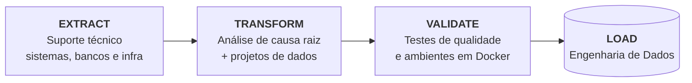

<h1 align="center">João</h1>

<p align="center">
  <a href="https://github.com/jpalmda">
    
  </a>
</p>

<p align="center">
  Analista de Suporte Jr II na Linx/Totvs · Estudante de Sistemas de Informação na Unifafibe
</p>

<p align="center">
  <a href="https://www.linkedin.com/in/joaoppalmda/"></a>
  <a href="mailto:joaoppalmda@gmail.com"></a>
</p>

---

## Sobre

Trabalho no dia a dia com sistemas, bancos de dados e infraestrutura, investigando a causa raiz de problemas técnicos e entregando soluções. Essa rotina me deu o olhar que levo para dados: **um pipeline só vale se for confiável quando algo dá errado.**

Estou migrando para Engenharia de Dados, construindo projetos ponta a ponta com foco em orquestração, transformação, qualidade de dados e ambientes reproduzíveis com Docker.

## Projetos

| Projeto | O que faz | Stack |
|---|---|---|
| [**etl-bcb-airflow-dbt**](https://github.com/jpalmda/etl-bcb-airflow-dbt) | Ingere SELIC, IPCA e dólar da API do Banco Central, transforma com dbt e valida com testes de qualidade. Orquestrado com Airflow. | `Python` `Airflow` `dbt` `Docker` |
| [**spark-multas-sp**](https://github.com/jpalmda/spark-multas-sp) | Processa e analisa ~1 milhão de registros reais de multas do DETRAN-SP com agregações e window functions. | `PySpark` `Parquet` `Matplotlib` |
| [**airflow-etl-dolar**](https://github.com/jpalmda/airflow-etl-dolar) | Pipeline agendado no Airflow que extrai a cotação do dólar e persiste em PostgreSQL. | `Python` `Airflow` `PostgreSQL` `Docker` |
| [**etl-cotacao-dolar**](https://github.com/jpalmda/etl-cotacao-dolar) | ETL da cotação do dólar com tratamento em Pandas e carga em PostgreSQL via Docker Compose. | `Python` `Pandas` `PostgreSQL` `Docker` |

## Stack

| | |
|---|---|
| **Linguagens** |   |
| **Orquestração e transformação** |     |
| **Armazenamento** |   |
| **Infra e ferramentas** |    |

## Minha carreira como pipeline



Quem passa o dia investigando por que algo quebrou aprende cedo que dado ruim e sistema instável têm a mesma origem: falta de observabilidade. É essa mentalidade que levo para os pipelines.

```sql
SELECT nome, cargo_atual, formacao, foco, stack
FROM   joao.perfil
WHERE  aberto_a_oportunidades = TRUE;

-- nome         | João
-- cargo_atual  | Analista de Suporte Jr II
-- formacao     | Sistemas de Informação
-- foco         | Engenharia de Dados
-- stack        | {Python, SQL, Airflow, dbt, Spark, Docker}
```

---

<picture>
  <source media="(prefers-color-scheme: dark)" srcset="https://raw.githubusercontent.com/jpalmda/jpalmda/output/github-contribution-grid-snake-dark.svg" />
  <source media="(prefers-color-scheme: light)" srcset="https://raw.githubusercontent.com/jpalmda/jpalmda/output/github-contribution-grid-snake.svg" />
  
</picture>

<p align="center">
  Aberto a conversar sobre dados, projetos e oportunidades na área.
</p>
